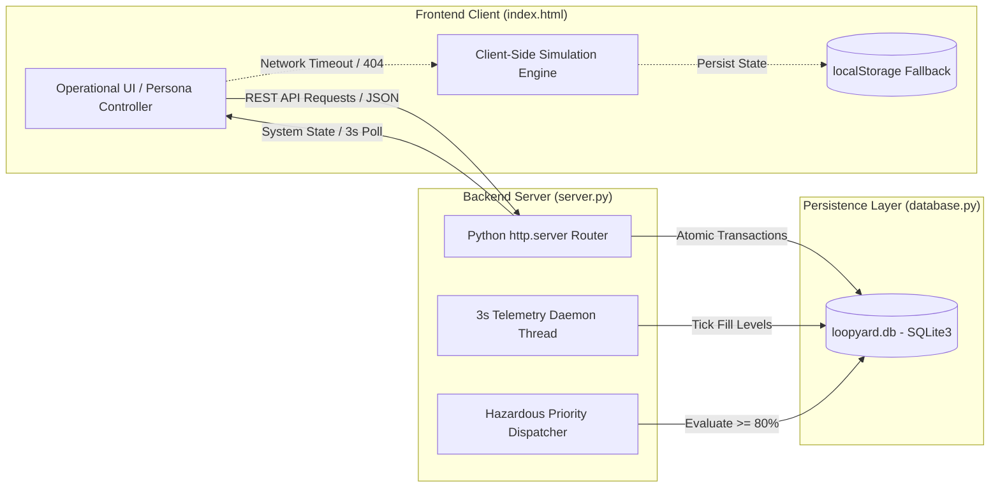

<div align="center">

# LoopYard

### Closed-Loop Industrial Waste Exchange & Factory Symbiosis Engine

A zero-dependency operational dashboard and matching platform that transforms industrial byproducts from producer facilities into certified raw material feedstocks for consumer facilities.

[](https://python.org)
[](https://sqlite.org)
[](#architecture)
[](https://vercel.com)
[](LICENSE)

</div>

---

<div align="center">

[Overview](#overview) &nbsp;•&nbsp;
[Core Capabilities](#core-capabilities) &nbsp;•&nbsp;
[System Architecture](#system-architecture) &nbsp;•&nbsp;
[Quick Start](#quick-start) &nbsp;•&nbsp;
[API Reference](#api-reference) &nbsp;•&nbsp;
[Project Structure](#project-structure) &nbsp;•&nbsp;
[Verification](#verification--tests)

</div>

---

## Overview

Industrial parks produce secondary material streams—solvents, oils, metal shavings, corrugated board, polymers, and organics—that are frequently landfilled at significant cost. Simultaneously, neighboring manufacturers purchase virgin material for identical production profiles.

**LoopYard** provides real-time telemetry, automated dispatch threshold control, and programmatic cross-facility material matching. It functions both as an autonomous Python backend service and as a standalone client-side simulator deployable to static hosts like Vercel with zero external libraries or runtime frameworks.

---

## Core Capabilities

| Capability | Technical Mechanism | Operational Value |
| :--- | :--- | :--- |
| **Industrial Symbiosis Engine** | Bidirectional graph matching between byproduct streams ($\ge 30\%$ fill) and neighboring consumer BOM requirements. | Eliminates disposal fees; creates circular feedstock exchange channels between adjacent facilities. |
| **Autonomous Dispatch Triggering** | Continuous sensor loop evaluating fill levels against an invariant $\ge 80\%$ critical threshold. | Eliminates manual dispatching; auto-generates prioritize tasks before bin overflow occurs. |
| **Hazardous-First Task Routing** | In-memory priority queue elevating Class 1 streams (`solvent`, `oil`) above standard bulk streams. | Mitigates environmental compliance risk by guaranteeing rapid hauler response for regulated substances. |
| **Partial Bin Evacuation** | Proportional offloading calculation (`-25%`, `-50%`) with automatic task resolution when fill drops $<80\%$. | Supports fractional collection routes and non-standard tanker evacuations without resetting valid telemetry. |
| **Lifecycle Impact Ledger** | Real-time KaTeX/ISO-aligned carbon avoidance factor accounting ($2.1\text{ kg CO}_2\text{e/kg}$ metal, $1.8$ oil, etc.). | Generates auditable ESG diversion metrics with verified per-pickup ledger entries. |
| **Tri-Persona Adaptive Views** | Role-segmented UI states: **Park Manager** (macro audit), **Collector** (sticky route queue), and **Tenant** (inbound/outbound matching). | Delivers contextual operational surfaces for plant managers, drivers, and park directors. |

---

## System Architecture



### Architectural Properties
- **Zero External Dependencies:** Implemented strictly with the Python Standard Library (`http.server`, `sqlite3`, `json`, `urllib`) and native browser APIs (Fetch, CSS Grid, Web Storage).
- **Dual Runtime Support:** Automatically probes `/api/state`. If running on a static CDN (e.g., Vercel), it transparently pivots to an in-browser deterministic simulation loop with zero degraded features.

---

## Quick Start

### 1. Clone the Repository
```bash
git clone https://github.com/proshivam420-hash/LoopYard.git
cd LoopYard
```

### 2. Launch the Local Server
```bash
# Uses Python 3 Standard Library - no pip install required
python3 server.py
```

### 3. Open the Dashboard
Navigate to `http://localhost:8000` in your web browser.

> **Deploying to Vercel:**  
> The project includes a pre-configured `vercel.json`. Push your fork to GitHub and import it directly into Vercel. The platform will serve `index.html` statically with automatic client-side fallback.

---

## API Reference

The backend exposes an atomic JSON REST API running on port `8000`:

| Method | Endpoint | Request Payload | Description |
| :--- | :--- | :--- | :--- |
| `GET` | `/api/state` | _None_ | Retrieves aggregated park state (tenants, bins, queue, logs, matches, impact metrics). |
| `GET` | `/api/bins` | _None_ | Retrieves array of 11 monitored industrial bins and current capacities. |
| `GET` | `/api/pickups` | _None_ | Retrieves active dispatch tasks sorted by `P1 HAZARDOUS` first, then FIFO timestamp. |
| `GET` | `/api/compliance`| _None_ | Returns immutable audit ledger of completed material collections. |
| `GET` | `/api/matches` | _None_ | Returns active cross-factory raw material matching opportunities. |
| `GET` | `/api/impact` | _None_ | Computes landfill diversion rate (%) and net avoided carbon ($\text{kg CO}_2\text{e}$). |
| `GET` | `/api/demo_users`| _None_ | Returns available demo personas and evaluation profiles. |
| `POST` | `/api/bins/dump` | `{"bin_id": 4, "amount_pct": 25.0}` | Simulates factory production output; triggers auto-dispatch if fill reaches $\ge 80\%$. |
| `POST` | `/api/partial_collect` | `{"bin_id": 1, "percent": 50.0}` | Evacuates partial volume; auto-closes open pickup task if resulting fill drops $<80\%$. |
| `POST` | `/api/pickups/complete`| `{"pickup_id": 2}` | Certifies task completion, resets bin fill to `0.0%`, and writes verified compliance record. |
| `POST` | `/api/demo_users` | `{"name": "...", "role": "...", "scope": "..."}` | Provisions an ad-hoc pitch persona synchronized to SQLite. |
| `POST` | `/api/simulation/toggle` | _None_ | Pauses or resumes the 3-second background IoT telemetry generator thread. |
| `POST` | `/api/reset` | _None_ | Reseeds database back to canonical 6-tenant, 11-bin industrial park baseline. |

---

## Project Structure

```text
LoopYard/
├── database.py                 # SQLite schema, seed data, and circular matching business logic
├── server.py                   # Multi-threaded HTTP server and telemetry simulation daemon
├── index.html                  # Root dashboard (Vercel-compatible single-page web app)
├── static/
│   └── index.html              # Mirror asset served by Python http.server
├── vercel.json                 # Static routing configuration for Vercel deployment
├── test_system.py              # Automated unit tests for circular PDR logic and thresholds
├── test_api.py                 # Endpoint integration and contract tests
├── test_partial_collect.py     # Verification tests for partial volume offloading
├── test_demo_users.py          # Identity and persona management tests
├── LoopYard_Presentation.pptx  # Deck for project stakeholders and pitch evaluation
├── README.md                   # Technical system documentation
└── README.pdf                  # Rendered documentation for distribution
```

---

## Verification & Tests

The project includes unit and integration suites with zero test-runner requirements:

```bash
# Run business logic, threshold, and carbon avoidance tests
python3 test_system.py

# Verify partial collection math and auto-resolve states
python3 test_partial_collect.py

# Verify demo persona provisioning and REST routes (requires server.py running)
python3 test_demo_users.py

# Run standard unittest discovery
python3 -m unittest discover -p "test_*.py"
```

---

## License

This project is licensed under the [MIT License](LICENSE).
